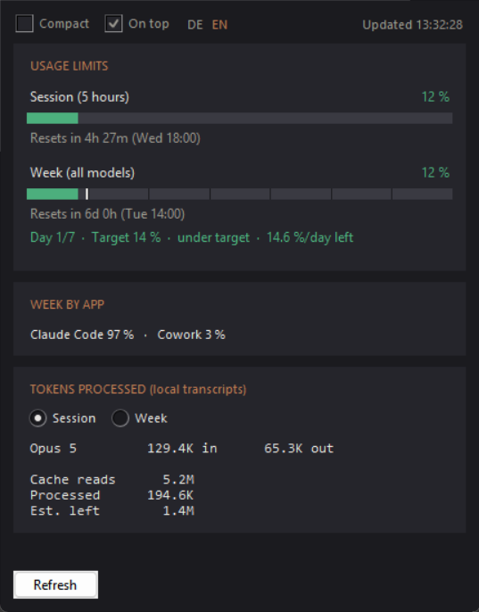
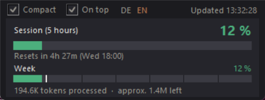

# Claude Token Usage

*[Deutsch](README.md) · English*

A small desktop window showing the same numbers as `/usage` in Claude Code —
plus a pacing marker that tells you whether you are spending your weekly limit
evenly or too fast.

## Running it

Double-click `Claude Token Usage.bat` (or `claude_usage.pyw` directly).
Needs Python 3 with Tkinter on Windows. No other dependencies — one file,
standard library only.

## Language

The interface speaks English or German, switched with **DE/EN** in the header;
the active language is highlighted. The choice applies instantly to every text,
including number formats (`16.9M` versus `16,9 Mio`), weekday abbreviations and
error messages, and is remembered in `einstellungen.json`. All strings live in
the `TEXTE` dictionary at the top of the file — a third language costs one
column there and one entry in `SPRACHEN`.

## Two views

* **Full** – every limit, the week split by app, and the token breakdown.
* **Compact** – the 5-hour limit in large type, below it the weekly bar with
  its day grid and target mark, plus tokens processed and the remaining
  estimate. The weekly countdown and the pacing comparison live in the full
  view.

Switch with the **Compact** checkbox at the top left or by double-clicking the
window. Next to it sits **On top**; the right edge shows when the data was last
fetched. The *Refresh* button appears in the full view only; **F5** works in
both. The chosen view, both window sizes, the on-top switch and the language are
remembered in `einstellungen.json` next to the program; delete the file and it
starts with defaults again. The full view grows by itself if the remembered
height does not fit the content — the token list and the pacing line only fill
up once the data arrives. It never shrinks on its own.

## What it shows

**Usage limits** – fetched from the OAuth endpoint
`api.anthropic.com/api/oauth/usage`, so exactly the values behind `/usage`:

* session (5-hour window) and week, each as a percentage with a countdown to the reset
* further limits (e.g. the Opus week) if your plan reports them
* the week split by app (Claude Code / chats / Cowork)

The weekly bar is additionally divided into **seven day cells** (six thin
separators), and a solid vertical **target marker** shows where usage should
stand right now: at the time-proportional value that spreads evenly until the
reset. That is 100 %/7 ≈ 14.3 % per day, computed continuously — after three
and a half days the marker sits in the middle of the fourth cell. While the fill
stays behind the marker you are on target; once it pushes past, you are going
too fast.

The numbers below spell it out: `Day 4/7 · Target 43 % · under target ·
13.8 %/day left`. Only the direction is named — `under target`, `on target`,
`over target`; how large the gap is can be read from the two percentages next to
each other (target 43 % against the 37 % in the row above). The colour says how
serious it is: green, yellow from 2, red from 10 percentage points apart.

It deliberately says **target** and not "limit": the limit is the whole week and
would only be exceeded at 100 %. The target is the value an even burn would have
reached by now — a marker that moves with the clock, not a boundary of your
plan.

`13.8 %/day left` is your budget from now on if the remainder is spread evenly
over the remaining time; during the last 24 hours it says how much is left until
the reset instead. The comparison uses the locally extrapolated value (see
*Polling*) where one exists. Marker and day counter advance every second; when
the window rolls over, the marker starts at the left again. The grid spacing
follows the actual window length reported by the API — seven days is only the
fallback.

**Tokens processed** – the API reports percentages only, never token counts. The
actual numbers are therefore counted from the local transcript files
(`~/.claude/projects/**/*.jsonl`), filtered to exactly the two limit windows.
Both the Windows directory `%USERPROFILE%\.claude` and the `.claude` directories
of every installed WSL distribution are included. Messages appearing more than
once (forks, compaction) are counted once, keyed by message ID.

`Processed` counts input, output and cache writes. Cache reads have a line of
their own and stay out of that total: they re-read the same context with every
message, so they grow with the length of a session alone and would dominate the
total — and they count towards the limits only at a fraction.

`Est. left` extrapolates from tokens counted and utilization reported how much
is left in the window. It is an estimate: the limits also include usage outside
Claude Code (see the split by app), which is invisible locally.

## Credentials

The access token is read from Claude Code's `.credentials.json`; with several
installations the most recently refreshed one wins. It is sent to
`api.anthropic.com` and nowhere else, and is never displayed or stored. If the
window reports an expired token, starting Claude Code once is enough.

## Polling

Limits are fetched every 5 minutes. In between, the program refreshes only the
local transcripts every 30 seconds (no network access) and extrapolates the
percentage from them: the last real fetch says how many tokens make up one
percentage point, and the growth counted since is converted with it. Both values
are shown — `41 % · ≈45 %`, where the `≈` marks the computed one; in the bar it
appears as a hatched segment behind the confirmed part. When the 5-hour window
rolls over (reset reached), a real fetch happens instead of extrapolating. The
countdown keeps ticking every second (computed locally).

The extrapolation is an estimate with the same caveat as `Est. left`: it assumes
new usage affects the limit in the same ratio as it did up to the last fetch. It
cannot see usage outside Claude Code (chats, Cowork); the next real fetch
corrects the value. The interval is deliberately not shorter: Claude Code itself
and the web/desktop apps hit the same endpoint, and polling it too often is
counted jointly — the answer is then `HTTP 429` (throttling, unrelated to your
own usage limits).

On a 429 the program waits 5, then 10, 20 and at most 30 minutes before trying
again; if the server names its own delay in the `Retry-After` header, that wins.
The values fetched last stay on screen meanwhile, and the locally counted tokens
keep refreshing regardless.

## Worth knowing

The endpoint `api.anthropic.com/api/oauth/usage` is **undocumented**. Claude Code
and the apps use it themselves, but Anthropic has made no promises about it: it
may change or disappear at any time, leaving the window with only the locally
counted tokens. The program reads the OAuth token from Claude Code's credentials
file and sends it to that endpoint only — there is no other outbound connection
and nothing is logged. If you want to check: `hole_limits()` is the single place
that touches the network.

This project is not affiliated with Anthropic.

## A note on the code

Identifiers, comments and the German texts are in German, since that is the
author's language. The structure should still be readable: `Limitbalken` is the
bar widget, `UsageFenster` the window, `zaehle_tokens()` the transcript counter,
`hole_limits()` the single network call, and `TEXTE` holds every user-visible
string.

## License

MIT, see [LICENSE](LICENSE).
