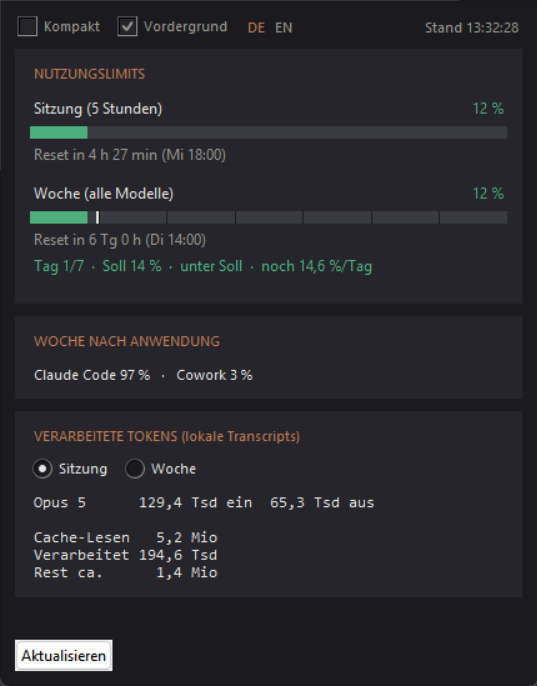
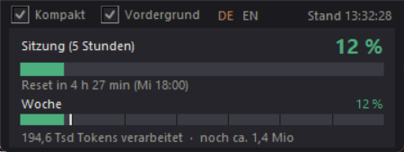

# Claude Token Usage

*Deutsch · [English](README.en.md)*

Kleines Desktop-Fenster, das dieselben Zahlen zeigt wie `/usage` in Claude Code –
mit einer Soll-Marke, die zeigt, ob das Wochenlimit gleichmäßig verbraucht wird.

## Starten

Doppelklick auf `Claude Token Usage.bat` (oder direkt auf `claude_usage.pyw`).
Voraussetzung: Python 3 mit Tkinter unter Windows.

## Sprache

Die Oberfläche spricht Deutsch oder Englisch. Umgeschaltet wird über **DE/EN**
in der Kopfzeile – die aktive Sprache steht hervorgehoben. Die Wahl gilt sofort
für alle Texte, auch für Zahlenformate (`16,9 Mio` gegenüber `16.9M`),
Wochentagskürzel und Fehlermeldungen, und wird in `einstellungen.json` gemerkt.
Die Texte stehen gesammelt im Wörterbuch `TEXTE` am Anfang der Datei; eine
weitere Sprache kostet eine Spalte dort und einen Eintrag in `SPRACHEN`.

## Zwei Ansichten

* **Vollansicht** – alle Limits, Aufteilung der Woche und die Tokenaufstellung.
* **Kompakt** – das 5-Stunden-Limit groß, darunter der Wochenbalken mit
  Tagesraster und Soll-Marke, dazu die verarbeiteten Tokens und die
  Restschätzung. Countdown und Soll-Ist-Vergleich der Woche stehen in der
  Vollansicht.

Umschalten über das Häkchen **Kompakt** oben links oder per Doppelklick ins Fenster.
Daneben liegt **Vordergrund** (Fenster bleibt über anderen), rechts der Stand der
letzten Abfrage. Der Knopf *Aktualisieren* erscheint nur in der Vollansicht; **F5**
frischt in beiden Ansichten auf. Die zuletzt gewählte Ansicht, beide Fenstergrößen
und der Vordergrund-Schalter werden
in `einstellungen.json` neben dem Programm gemerkt; wird die Datei gelöscht,
startet es wieder mit den Standardwerten. Die Vollansicht wächst von selbst
nach, falls die gemerkte Höhe für den Inhalt nicht reicht – Tokenliste und
Soll-Zeile füllen sich erst mit den Daten. Verkleinert wird nie.

## Was angezeigt wird

**Nutzungslimits** – abgerufen vom OAuth-Endpunkt `api.anthropic.com/api/oauth/usage`,
also exakt die Werte aus `/usage`:

* Sitzung (5-Stunden-Fenster) und Woche, jeweils in Prozent mit Countdown bis zum Reset
* weitere Limits (z. B. Opus-Woche), falls der Tarif sie liefert
* Aufteilung der Woche nach Anwendung (Claude Code / Chats / Cowork)

Der Wochenbalken ist zusätzlich in **sieben Tagesfelder** geteilt (sechs feine
Trennlinien), und eine kräftige senkrechte **Soll-Marke** zeigt, wo der Verbrauch
jetzt stehen dürfte: beim zeitlich anteiligen Wert, der gleichmäßig bis zum Reset
reicht. Das sind 100 %/7 ≈ 14,3 % je Tag, stufenlos gerechnet – nach dreieinhalb
Tagen steht die Marke also mitten im vierten Feld. Bleibt die Füllung hinter der
Marke, bist du im Soll; schiebt sie sich darüber, bist du zu schnell.

Darunter die Zahlen dazu: `Tag 4/7 · Soll 43 % · unter Soll · noch 13,8 %/Tag`.
Genannt wird nur die Richtung – `unter Soll`, `im Soll`, `über Soll`; wie groß
der Abstand ist, steht als Prozentwert daneben (Soll 43 % gegen die 37 % im
Kopf der Zeile). Die Farbe zeigt, wie ernst es ist: grün, gelb ab 2, rot ab
10 Prozentpunkten Abstand.

Es heißt bewusst **Soll** und nicht „Limit": Das Limit ist die ganze Woche und
wäre erst bei 100 % überschritten. Das Soll ist der Wert, den ein gleichmäßiger
Verbrauch jetzt gerade erreicht hätte – eine wandernde Marke, keine Grenze des
Tarifs. „Plan" wäre ebenfalls falsch, denn geplant hat diesen Wert niemand; er
ergibt sich allein aus der verstrichenen Zeit.

`noch 13,8 %/Tag` ist das Budget ab jetzt, wenn der Rest gleichmäßig auf die
verbleibende Zeit verteilt wird; in den letzten 24 Stunden steht dort stattdessen,
wie viel bis zum Reset übrig ist. Verglichen wird mit dem lokal fortgeschriebenen
Wert (siehe *Abrufhäufigkeit*), sofern es einen gibt. Marke und Tageszähler wandern
sekündlich mit der Uhr weiter; springt das Fenster um, fängt die Marke wieder links
an. Die Rasterweite richtet sich nach der tatsächlichen Fensterlänge aus der API,
sieben Tage sind nur der Rückfall.

**Verarbeitete Tokens** – die API nennt nur Prozentwerte, keine Tokenzahlen. Die
tatsächlichen Zahlen werden deshalb aus den lokalen Transcript-Dateien
(`~/.claude/projects/**/*.jsonl`) ausgezählt, gefiltert auf genau die Zeitfenster
der beiden Limits. Berücksichtigt werden sowohl das Windows-Verzeichnis
`%USERPROFILE%\.claude` als auch die `.claude`-Verzeichnisse in allen installierten
WSL-Distributionen. Mehrfach vorkommende Nachrichten (Fork, Kompaktierung) werden
über die Message-ID nur einmal gezählt.

`Verarbeitet` zählt Eingabe, Ausgabe und das Anlegen des Caches. Die
Cache-Lesevorgänge stehen in einer eigenen Zeile und bleiben aus dieser Summe
heraus: Sie lesen denselben Kontext bei jeder Nachricht erneut, wachsen damit
allein durch die Länge einer Sitzung und würden die Summe sonst beherrschen –
in die Limits gehen sie nur zu einem Bruchteil ein.

`Rest ca.` rechnet aus verarbeiteten Tokens und Auslastung hoch, wie viel im Fenster
noch übrig ist. Das ist eine Schätzung: In die Limits fließt auch Nutzung außerhalb
von Claude Code ein (siehe Aufteilung nach Anwendung), die lokal nicht sichtbar ist.

## Anmeldung

Der Zugriffstoken wird aus `.credentials.json` von Claude Code gelesen; bei mehreren
Installationen gilt der zuletzt erneuerte. Er wird ausschließlich an
`api.anthropic.com` gesendet und nirgends angezeigt oder gespeichert. Meldet das
Fenster einen abgelaufenen Token, genügt es, Claude Code einmal zu starten.

## Abrufhäufigkeit

Die Limits werden alle 5 Minuten geholt. Dazwischen frischt das Programm alle
30 Sekunden nur die lokalen Transcripts auf (kein Netzzugriff) und schreibt den
Prozentwert daraus fort: Der letzte echte Abruf sagt, wie vielen Tokens ein
Prozentpunkt entspricht, der seither gezählte Zuwachs wird damit umgerechnet.
Angezeigt werden beide Werte – `41 % · ≈45 %`, wobei der mit `≈` markierte Wert
der berechnete ist; im Balken erscheint er als gerastertes Segment hinter dem
bestätigten Teil. Springt das 5-Stunden-Fenster um (Reset erreicht), wird statt
fortgeschrieben sofort echt abgefragt. Der Countdown läuft sekündlich weiter
(rein lokal gerechnet).

Die Fortschreibung ist eine Schätzung mit derselben Einschränkung wie `Rest ca.`:
Sie nimmt an, dass der Zuwachs im selben Verhältnis auf das Limit wirkt wie bis
zum letzten Abruf. Nutzung außerhalb von Claude Code (Chats, Cowork) sieht sie
nicht; der nächste echte Abruf korrigiert den Wert. Bewusst kein kürzerer Takt: Auf denselben Endpunkt greifen
auch Claude Code selbst und die Web-/Desktop-App zu, und zu häufiges Abfragen wird
gemeinsam gezählt – die Antwort ist dann `HTTP 429` (Drosselung, nichts mit den
eigenen Nutzungslimits zu tun).

Tritt 429 auf, wartet das Programm 5, dann 10, 20 und höchstens 30 Minuten bis zum
nächsten Versuch; nennt der Server im Header `Retry-After` eine eigene Wartezeit,
gilt diese. Die zuletzt geholten Werte bleiben währenddessen stehen, die lokal
gezählten Tokens werden unabhängig davon weiter aufgefrischt.

## Was man wissen sollte

Der Endpunkt `api.anthropic.com/api/oauth/usage` ist **nicht dokumentiert**.
Claude Code und die Apps benutzen ihn selbst, aber Anthropic hat ihn nicht
zugesagt: Er kann sich jederzeit ändern oder wegfallen, dann zeigt das Fenster
nur noch die lokal gezählten Tokens. Das Programm liest den OAuth-Token aus der
Anmeldedatei von Claude Code und schickt ihn ausschließlich an diesen Endpunkt –
es gibt keine weitere Verbindung nach außen, nichts wird protokolliert. Wer das
nachsehen will: `hole_limits()` ist die einzige Stelle mit Netzzugriff.

Dieses Projekt steht in keiner Verbindung zu Anthropic.

## Lizenz

MIT, siehe [LICENSE](LICENSE).
